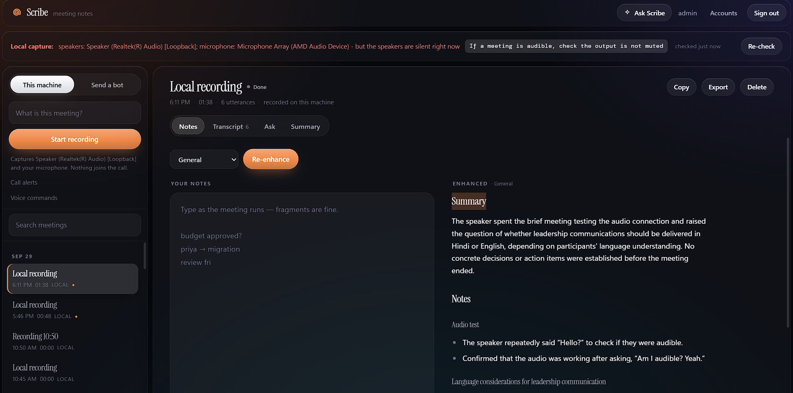
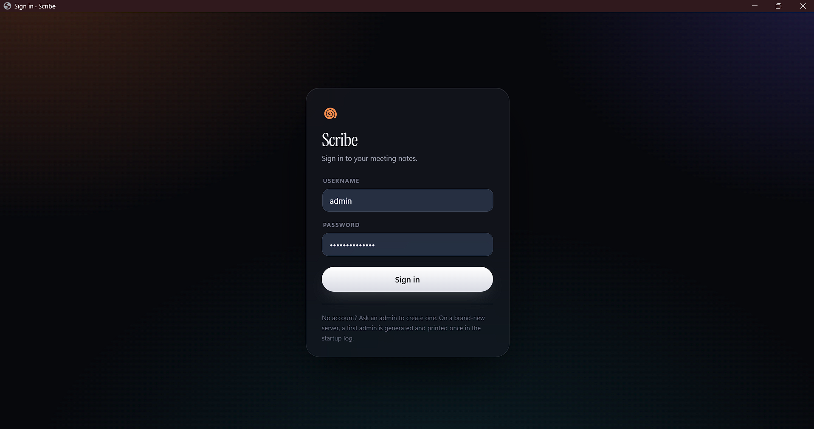

# Scribe — meeting notes, without a bot in the call

[](https://github.com/neilss170/meet-notes-bot/actions/workflows/tests.yml)
[](https://www.python.org/downloads/)
[](LICENSE)

Records your meetings, transcribes them, and turns your rough notes into good
ones. **Nothing joins the call.**



Scribe listens to what your speakers are already playing and what your
microphone is already hearing, so there is no bot in the participant list, no
Google account to expire, and no lobby to be admitted through. It works with
Google Meet, Zoom, Teams, or a phone on speaker &mdash; to the recorder they
are all just audio arriving at your sound card.

Alongside it there is a **notepad**. You type whatever you can while the
meeting runs — fragments, a name and an arrow — and Scribe fills those notes
in from the transcript afterwards. Your notes stay the spine: their order,
their emphasis and their wording survive, and the model's job is to expand
the shorthand and attach the numbers, owners and dates you had no time to
write. You can also ask questions of a finished meeting, answered only from
what was actually said.

It runs on your own machine. Audio goes to Deepgram for transcription and the
transcript goes to one LLM call for the summary; nothing else leaves the host,
and no virtual audio device has to be installed.

---

## Install

### The Windows app

Download `Scribe-Setup-<version>.exe` and run it — no Python needed. Scribe
starts in the notification area and opens signed in. Put your Deepgram and LLM
keys in **tray → Settings and API keys** (`%APPDATA%\Scribe\.env`).

The installer is not code-signed yet, so Windows SmartScreen will say
*"Windows protected your PC"*: choose **More info → Run anyway**.

Your data lives in `%APPDATA%\Scribe` — recordings, settings, accounts, and the
logs in `logs\` — and survives uninstalling unless you tick *remove my data*.
Building the installer, and everything else about the app:
[docs/desktop-app.md](docs/desktop-app.md).

### From source

You need **Python 3.11+**, a [Deepgram](https://console.deepgram.com/) key for
transcription, and one key for the write-up: [Anthropic](https://console.anthropic.com/settings/keys),
[OpenAI](https://platform.openai.com/api-keys) or
[Gemini](https://aistudio.google.com/apikey) — set `LLM_PROVIDER` to whichever
you have. Anything that speaks the OpenAI wire format works too, Groq
included; see [docs/configuration.md](docs/configuration.md).

```bash
git clone https://github.com/neilss170/meet-notes-bot.git
cd meet-notes-bot

python -m venv .venv
.venv\Scripts\activate           # macOS/Linux: source .venv/bin/activate

pip install -e ".[all]"
python -m meetbot setup          # writes .env, says which keys it still needs
```

Put the two keys in the `.env` that `setup` just created, then:

```bash
python -m meetbot check          # proves the keys work, before you need them to
python -m meetbot tray           # the app: web UI, plus an icon by the clock
```

`setup` and `check` are both safe to re-run as often as you like — `setup`
never overwrites an existing `.env`, and `check` joins nothing. Once it says
`Ready to record`, you are done.

> **Recording this machine is Windows-only.** It uses WASAPI loopback, which
> is how the speakers get captured without installing anything. Everything
> else — the web UI, the notepad, the summaries, bot mode — works anywhere.

To put Scribe on the Desktop so starting it is a double-click:

```bash
python -m meetbot shortcut --startup
```

After `pip install`, `meetbot ...` works as a shortcut for
`python -m meetbot ...` whenever the virtual environment is active.

---

## Your first recording

Start `tray` (or `serve --open`), sign in with the admin password it prints on
first run, and press record. Change that password from **Accounts** once you
are in.

<p align="center">
  
</p>

Or stay in the terminal:

```bash
python -m meetbot record --list-devices      # what can be captured
python -m meetbot record --title "Standup"   # Ctrl+C to stop and write it up
```

Either way you end up with a directory under `recordings/` holding the
transcript, the summary, and your notes — see
[docs/recording.md](docs/recording.md).

There is also a **bot mode**, for meetings that are not playing through this
machine: it sends a signed-in Chromium into the call and records from inside
it. It predates local capture and is no longer the default, because it needs
a Google account of its own (`python -m meetbot login`) — Meet increasingly
refuses anonymous guests, and Google expires the session on its own schedule.
[Recording a meeting](docs/recording.md) covers it.

---

## Documentation

| | |
|---|---|
| [The desktop app](docs/desktop-app.md) | Building the installer, where data and logs live, how it behaves |
| [Recording a meeting](docs/recording.md) | Every way to start one, what it produces, and the flags worth knowing |
| [Configuration](docs/configuration.md) | Everything that can go in `.env` |
| [Deploying it](docs/deploying.md) | On your own machine, shared on a network, or on a server with no sound card |
| [How it works](docs/architecture.md) | The pipeline, and where each part lives in the tree |
| [Consent and disclosure](docs/consent.md) | **Read before recording anybody** |
| [Known limitations](docs/limitations.md) | What is fragile, and what happens when it breaks |
| [Development](docs/development.md) | The tests, what they cover, and how secrets are handled |

> The package, module and CLI are still named `meetbot`; only the product name
> is Scribe. Renaming the module touches every import and is a separate job.

---

## Licence

MIT — see [LICENSE](LICENSE).
