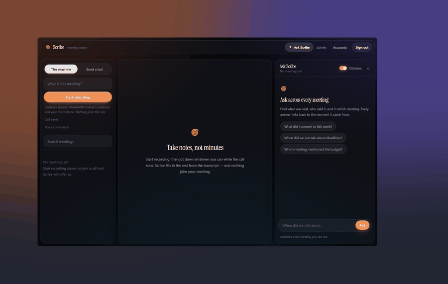
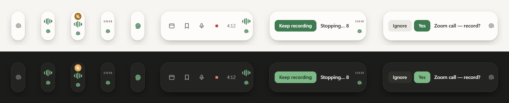

# The desktop app

Scribe for Windows, installed like any other program: `Scribe-Setup-<version>.exe`,
a Start-menu entry, an icon by the clock, no Python. It is the same Scribe —
the Electron app is a shell around the existing server and the existing page,
and changes neither.

```
Scribe.exe (Electron)                         scribe-server.exe (PyInstaller)
├── window ── http://127.0.0.1:<port>/ ───────▶ FastAPI: the page, the routes
├── tray   ── GET /api/meetings, POST …/stop ─▶   ├── local capture (WASAPI)
├── call notifications ── GET /api/calls ─────▶   ├── Deepgram, the LLM
└── quit   ── POST /api/control/shutdown ─────▶   └── %APPDATA%\Scribe
```

## Where things live

| | |
|---|---|
| `%APPDATA%\Scribe\.env` | Settings and API keys. Tray → **Settings and API keys** opens it |
| `%APPDATA%\Scribe\recordings\` | One folder per meeting, as before |
| `%APPDATA%\Scribe\state\` | Accounts, the session key, call-alert choices, chat history |
| `%APPDATA%\Scribe\logs\scribe-server.log` | The server's log. Tray → **Server log** |
| `%APPDATA%\Scribe\logs\scribe-shell.log` | The Electron shell's own log |
| `%APPDATA%\Scribe\shell\` | Window position and Chromium's cache |
| `%LOCALAPPDATA%\Programs\Scribe\` | The program. Replaced on every upgrade; nothing of yours is in it |

**Moving in from a from-source Scribe.** On first start the server copies what
an earlier `meetbot` left: the `.env` and `recordings\` of the checkout the
Desktop/Startup shortcut points at, and `~\.meetbot` (minus the bot's browser
profile, which stays put — `.env` still points at it). Copied, never moved;
`%APPDATA%\Scribe\migration.json` records what came from where. Set
`SCRIBE_LEGACY_DIR` to point it at a checkout the shortcut does not name. The
old Startup shortcut, if it ran Python, is renamed to
`Scribe.lnk.from-source-disabled` so the two do not both start at sign-in.

A fresh machine gets a `.env` copied from the template; until the Deepgram and
LLM keys are in it the page's readiness banner says what is missing.

## How it behaves

- **The window is signed in as you.** The shell holds a random token, passed
  to the server in its environment, that acts as the first admin — the same
  trust the tray icon has always had. Sign out to use another account.
- **Closing the window hides it.** Recording carries on; the tray icon brings
  it back. A second launch focuses the running one.
- **Quit** (tray) stops a live recording, waits for its transcript and notes,
  then exits. The shell waits up to three minutes before killing the server,
  and the server shuts itself down if the shell dies first. No orphaned
  `scribe-server.exe`.
- **Tray**: hover for status and the clock, click for the window, right-click
  for start/stop, **Mute my mic**, latest notes, folders, *Start Scribe when I
  sign in* (off by default) and Quit. Red while recording, amber while your mic
  is muted. **Ctrl+Alt+M** mutes from anywhere.
- **"A call started"** arrives as a Windows notification with **Record** and
  **Ignore**.
- **Locked down**: sandboxed, no Node in the page, context isolation, and it
  cannot navigate to, or load anything from, anywhere but its own server.
  Links elsewhere open in your browser.

## The floating bubble



Minimising Scribe — or closing it — no longer sends it to the taskbar. The
window flies into a slim pill that sits against the right edge of the screen,
above everything, with no taskbar button. Click it to go back to the note (the
same flight in reverse); drag it anywhere and it springs to the nearest side,
and it remembers where it was on each display.



- It wears the page's recording bars. **Idle**: just the spiral.
  **Recording**: iris bars moving with the room, and a soft halo. **Held** (starting,
  wrapping up, about to stop): grey and still. **Mic muted**: an amber badge.
  **Writing notes**: the spiral turns.
- **Hover** for a moment and it opens: Start/Stop recording (the one accented
  button), *Mute my mic* and *Mark this moment* while recording, *Back to the
  note*, and the recording's clock. Keys: R, M, K, O.
- **About to stop by itself** (see *Stopping by itself* in
  [recording.md](recording.md)): it opens with **Keep recording**.
- **A call starts**: it bounces once and asks *Record?* — Yes or Ignore —
  instead of a notification.
- **Right-click**: Open, Hide bubble, Quit.
- **Ctrl+Alt+S** goes window ⇄ bubble from anywhere, and leaves the keyboard
  on the pill so the keys above work.

It never takes focus from the call — it is shown without activating, and
updates never raise it — and it is hidden from screen shares by default.
Settings are in the tray menu: *Minimise to floating bubble* (on), *Always
show bubble* (off), *Hide bubble during screen share* (on).

**How the animation works on Windows**, which has no genie effect to borrow.
Windows' own minimise animation is switched off for this one window
(`DWMWA_TRANSITIONS_FORCEDISABLED`, through `koffi`), and the shell draws the
flight itself on a transparent, click-through overlay. Smooth comes from
preparing everything before it is needed: the moment the mouse goes *down* on
minimise or close — Windows acts on release — the window is photographed and
the picture is placed exactly over it, so when the window goes the flight
starts on the very next frame (measured: 0 ms, down from 140 ms of blank
screen in the first version). It follows one continuous curve with a
symmetric ease over 420 ms, shrinking geometrically; the corners repaint only
when the rounding visibly changes. Restoring shows the real window under the
picture and waits for it to paint before the picture fades. With *reduce
motion* on in Windows it is a 120 ms crossfade. Any step that misses its
deadline jumps to the end; the overlay cannot be left on screen.

## Building it

Needs Node 20+ and Python 3.11 on a Windows machine. The server is frozen
from a virtualenv of its own (`build\server-venv`), not your global Python —
PyInstaller follows optional imports, and a global site-packages with torch
or Qt in it ends up in the executable.

```bash
cd electron
npm install

npm run dev           # the shell, with the server running from source
npm run build:server  # dist\scribe-server\scribe-server.exe (one-dir)
npm run build:app     # electron\release\win-unpacked, to try without installing
npm run dist          # icons + server + electron\release\Scribe-Setup-<version>.exe
npm run smoke -- --record 20                       # scripted run from source
npm run smoke -- "%LOCALAPPDATA%\Programs\Scribe\Scribe.exe" --record 20   # against the installed app
```

`npm run dev` uses the real `%APPDATA%\Scribe`; set `SCRIBE_DATA_DIR` for a
scratch one. `SCRIBE_PYTHON` picks the interpreter. From a VS Code terminal
the scripts clear `ELECTRON_RUN_AS_NODE`, which VS Code sets and which turns
`electron.exe` into plain Node.

The frozen server can be run on its own:

```bash
dist\scribe-server\scribe-server.exe --port 8765 --data-dir %TEMP%\scribe-test
```

## Not signed, yet

The installer and both executables are unsigned, so Windows SmartScreen says
*"Windows protected your PC"* on first run — **More info → Run anyway**. Signing
is a certificate away: see the commented block in `electron/electron-builder.yml`
(`CSC_LINK` / `CSC_KEY_PASSWORD`, or Azure Trusted Signing).

## Updates

`electron-updater` is wired to GitHub Releases on this repository and switched
off (`"scribe": { "autoUpdate": false }` in `electron/package.json`). Turning it
on needs a decision first: the repository is private, so publishing needs a
`GH_TOKEN`, and every installed copy would need a token to read releases.

## macOS, later

Everything platform-specific in the shell is in `electron/src/platform/`
(`win32.js`, a stub `darwin.js`); the rest is shared. A Mac build needs the
server frozen on a Mac, an `.icns`, the `mac:` block in `electron-builder.yml`
uncommented — and a loopback driver for the speakers, which the server does
not support yet.
